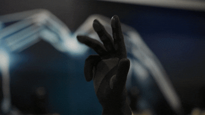
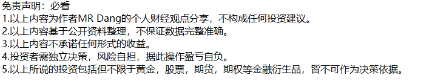

# 2026年3月26日财经早餐

这段时间以来，每天都要从伊朗局势开始：

昨天收盘后伊朗又重复了非敌对船只可通行的声明。

中远海运也发表公告，恢复部分敏感地区的新订舱业务。

值得注意的是，虽然恢复了，但这个是普通箱，而且走的**不是霍尔木兹海峡**，而是找了一条绕开霍尔木兹的路线，当然成本也会提升。

这些国家位置如图。

————————————

懂王又在赢了：声称伊朗已经弃核

当然，伊朗立马就光速打脸否认了。

伊朗媒体否认了几乎所有懂王的说法，并且抛出了一个懂王实际上是“自己和自己和谈”的观点，和懂王谈判不合逻辑。

伊朗不允许懂王决定停战时间：

西大众议院：不会进行地面作战

这个也不排除是烟雾弹，到时候搞什么奇袭夺岛的可能，朗子哥应该不会上第二次当了吧。

以色列：趁着能打赶紧打，赶在周末前找了个48小时的时间窗口。

有报道称周末在巴基斯坦谈判讨论停战：

感觉周末消息会比较多，持仓过周末的话，可能会面临比较大的波动。

**所以风险承受能力弱的投资者一定一定做好仓位管理，假设出了利空也能淡然处之，假设出了利好也不会扼腕叹息。**

————————————

老马的机器人又有新消息：

以后就业是真的难啊，体力劳动有机器人盯着，脑力劳动有ai盯着，唉。

看了演示视频，灵巧手真的很灵巧，20多个自由度，能覆盖人类手部大部分动作，看着很不错。

老马的特点就是一个方向盯住了就kuku爆产能，降低成本，所以可能会利好相关供应体系吧。

另外还有就是老马的space x要上市了，据传募集资金750亿绿票子，估值1.25万亿，人类历史之最。

这也可能会刺激到国内的商业航天板块。

现在老马就是资本市场顶流中的顶流。

————————————

Token有了个信达雅的翻译：**词元**

超算互联网免费赠送单人3000万词元额度，按照每千万词元价值一块来算的话，相当于人均三块。

以后词元这个词是会贯穿未来几年的大热，和电力一样，成为现代社会的基石。

投资的话，和词元相关的也是不错的方向，以后可能会专门开辟出来一个词元板块或者词元概念股。

————————————

外卖大战该结束了：经济日报发表同名社论

三色马甲已经很久没新闻了，之前热热闹闹的大战已经没了声量。

现在经济日报也让他们别打了：

不过我去蓝马甲家下单的时候还是偶尔会碰到不知道谁送的优惠券，算下来还是挺优惠的，每天下一单喜滋滋。

哦，对了，忘记说了，文章是盘中发的，黄马甲股票昨天已经大涨了，红蓝马甲小涨。

如果真的停战的话，肯定是对黄马甲最好，它一直处于下风和防守态势。

————————————

某公司要买1088亿的飞机：

飞机现在是抢手货，因为真的太缺了，造飞机的产能太低了，欧洲和西大的制造能力拉胯，要排单排很久的。

这家公司总市值960多亿，一口气下了千亿订单，大手笔，订单比市值都大。

这也从侧面反映出，飞机租赁确实是个好行业，处于景气周期。

这种排单的飞机是期货，飞机租赁公司手里的飞机算现货。

一般的经济规律是，如果期货需求旺盛，那么现货的价格也会得到支撑。

————————————

昨天香港某四字公司发布了业绩：

业绩发布后股价大跌，几个小时干没了五六百亿市值。

我记得在这公司如日中天的时候我在某乎写过一篇有关它的回答。那个时候还有时间闲逛，不知道还有没有读者对那个回答有印象的。

具体到这次的财报的话，其实也不是不好，但是之前对它的预期实在打的太高了。

四季度有投资者预期打到六七十亿，结果最后也就实现了一多半。

昨天业绩交流会上，公司表态努力做到20%增速，直接吓跑了投资者。

为啥呢？如果这样算的话，大概也就是说以后环比大概没啥增长了，从180%高增长公司一下变成了成熟期的慢增长公司。

现在跌下来以后是17pe左右，如果这个20%增速可以实现且持续的话，这个估值就还算不是很贵，处于较为合理的区间。

要是20%都保不住，那就难说了。

还有分红属实太抠门了，每股分这么一点，不够塞牙缝的，股东回报做的太一般了。

————————————

大宗商品：

昨天收盘后一直围绕懂王自说自话和伊朗明确拒绝在进行交易。

原油有些许抬头，有色整体观望情绪比较浓厚，都在等着懂王画线，锡相对来说比较强一些，但是也没强到哪里去。

外围市场：

整体氛围还行，三大股指都有上涨。

————————————

昨天个人净值回血一个半点，银行接近1，其他三个板块都是两点多，还行吧，勉强跑赢指数。

距离新高依然有挺长一段距离，不过也不是那么遥不可及了，可能得看银行的脸色了。

价值投资大部分时候没有那么多花里胡哨的操作，就是简单的不能再简单的等待，观察，判断。

接下来一段时间是财报密集披露的时间段，可能行情上波动也会加大，意味着操作难度也会更大，风险也会更大。

————————————

年报速递：

昨天佛光普照发布了业绩：

一般般，没什么超预期的，旅游股就这样，想象力不是很足。

股息的话，两个点还不到，整个旅游板块都差不多，缺乏高股息的公司。

一家保险巨头发布了业绩：净利润增长44%

老有人问，xxxx能不能代替银行，盈利也不错，也很稳。

这也算是一种答案吧，利润确实不错，但是就是不分，你能把他怎么办呢？

又有一家银行更新财报，边际改善明显，预期股息率接近5%，还不错的，就是可能名字有点劝退：

不太确定图挂了没有，如果图挂了的话，我等下发某乎。

最后还是想强调下，虽然长期来看冲突应该可控，但是短期事态进展是螺旋发展的，不管是下跌还是上涨，仓位控制一定要走在前头，不要一看反弹了就不管不顾了，昨天强调了，今天依然是这样。

————————————

一个喜欢保护韭菜的博主，希望大家少少踩坑，多多赚钱！！！

