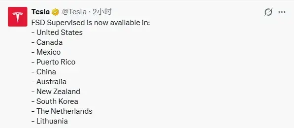

# 2026年5月22日财经早餐

很久没有把美伊局势放到头条了：

伊朗表示武器级的铀必须留在国内。

原油价格应声而起。

后面又有消息称马上达成协议：

原油价格直接跳水。

用语言描述可能说不清，贴一张原油走势图，大家就懂了：

好像对着美伊比了个中指。

原油不是一般人玩的，速速远离，没有开天眼根本玩不了。

——————————

巴铁5月23日到26日过来做客。

恩。。。朋友多是好事。。。

——————————

有关部门通过了《人民银行法》草案，将提请审议。

结合之前的征求意见稿内容，有业内人士猜测最大的变化是可能加入数字人民币有关内容，加大金融违法处罚力度。

——————————

特斯拉FSD监督版昨天官宣入华：

叫监督版，但其实是满血版的，而不是阉割版本。

FSD在哪个地区都是这个监督版，需要有人坐在驾驶位上进行监督。

当然所谓的监督，其实就是告诉你，驾驶者负有监督的责任，全责，它只是个L2级别的辅助驾驶。

老马父子，这趟没白来，比皮衣黄的成果多多了。

哦，对了，这个FSD售价6.4万，或者也可以月租。

昨天大盘那个样子，FSD板块是少数几个涨幅比较大的板块了。

——————————

量子产业：

懂王之前扶持英特尔，把很多订单给了它，硬是把日落西山的英特尔给救了回来。

这次把救助目标朝向了IBM这些企业，IBM在量子领域是标杆企业，现在国内的量子企业还在以IBM几年前的产品为追赶目标。

不过在量子通信这一细分领域，国内有一家企业已经做到了全球顶尖。

懂王深得东大“集中力量办大事”的精髓，在关键领域搞西大版的国企路线。

——————————

京东方发布了风险提示公告：

和康宁签订的合作协议里，玻璃基封装载板属于ai产业链的一环，所以引起了估值的抬升。

这个风险提示公告也基本把市场关切的点进行了回应，剩下的就是资金的博弈了。

这家企业也是散户大本营，股东数量常年都是百万级的，每次一有消息，都能冲到热度榜第一。

——————————

大宗商品：

受消息面影响，原油大幅波动后回调，有色整体回暖，农产品表现不佳。

美10年期长债收益率下行，A50期指主连预示今日可能会有个相对较好的开局。

外围市场：

美三大股指收红，道指领涨。

传统板块表现不错，科技股表现分化，存储走强，逆变器走强，英伟达在给出了一份不错的财报后回调。

市场对达子确实要求挺严的，预期打的太满了。

另外还有个土耳其市场，有报道称土耳其的美债卖的差不多了，再加上土耳其国内一些斗争，土耳其股市收盘跌了六个点。

大A不是倒数第一名！不是！

——————————

昨天个人组合净值回撤大半个，银行红半个，资源绿近一个，消费绿两个，算电绿近四个。

跟个等比数列一样。

上午笑嘻嘻，下午就笑不出来了，开始给算电还账，跳水跳得是如此丝滑。

甘蔗没有两头甜，之前算电涨的最好，现在回调一些也是应该的。

往好处想，起码还跑赢指数了，少亏当赢。

至于科技是破新高涨到天上去，还是继续回调，我个人是不太感兴趣的，我赚不了科技股的钱，但是也不想被科技掏了口袋，等什么时候确实便宜了，才会考虑。

昨天还在说最好不要被两边打耳光，但是我猜肯定有割了老登追科技的投资者被打的两耳通红。

银行是红的，固然让人欣慰，但其实心底没什么雀跃可言。

大概还有一个多月就要分红了，能复投更多的股票数量才是我更在意的点。

涨了是面子，跌了才是里子。

最惨的是消费，吃肉的时候没有，挨打的时候全在。

也对，都套在股市里，谁有钱消费，逻辑闭环了。

至于大盘，昨天大A收盘时的画风是这样的：

周围洋溢着一片欢声笑语，想找个把大盘带崩的罪魁祸首，还不好找。

有小作文称是量化交易相关的监管消息带崩了指数。

不予置评，这种聊天截图不算置信度高的信源。

但是莫名其妙挨了一顿暴打，画风和其他市场差距也有点大，大家都憋了一肚子气。

总要有个情绪发泄口，所以这锅就先甩给量化好了。

——————————

昨天评论区有圈友问医保白名单的事，不知道什么原因，被和谐了。打了挺长一段字，没发出去，我又单独发了个评论，不过可能很多读者没看到，所以今天写在正文里。

首先事情是有关部门发布了《关于进一步加强定点零售药店职工基本医疗保险个人账户使用监督管理的通知》，以下简称通知。

通知要求各省在今年9月底前，建立各省的医保白名单。

只有在白名单内的东西，才可以刷**职工**医保的**个人账户**。

这个很明显是为了堵住“医疗面膜”“医疗牙刷”这种口子。

我个人认为这个通知有两方面影响：

第一是根据第三方统计平台，比如中康科技之类的数据，头部连锁药店（药店三傻），非药品占总营收比例大约10%到15%之间，其中个人职工医保支付比例大约20%左右。

所以影响总营收可能是两三个点左右。

但是非药品毛利高一些，所以影响净利润可能就是三四个点左右。

这是不利影响。

第二个影响，其实单体非连锁药店，这部分非药品比例在40%到60%，其中个人职工医保支付比例大约是四成左右。

算下来影响就大很多，大概影响营收的20%，影响净利润接近四五成，比头部连锁药店大很多。

因为单体药店更不规范，监管更松，所以路子更野。

可以预料到接下来会有一大批单体药店闭店或者变成连锁药店，加速行业洗牌出清速度。

另外还有个**中药饮片**，完全不受限制，同时也是药店毛利最高的一块业务，那些个人医保账户里的钱，本来买保健品的，就会转向购买各种滋补品和中药饮片。

从这个角度考虑，对头部连锁是有利影响。

明天圈内更新大宗商品，感觉大家都比较爱看。

其实对我来说更新大宗是最简单的，反倒是其他内容要费不少心思。

想看的大宗商品可以打在评论区，不一定都能满足，会尽量考虑。

评论区有自己想看的就点赞，我会根据点赞数量挑选。

——————————

一个喜欢保护韭菜的博主，希望大家少少踩坑，多多赚钱！！！

