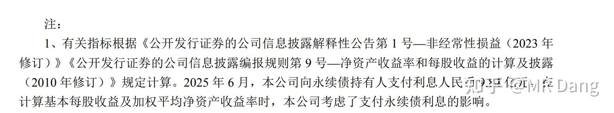
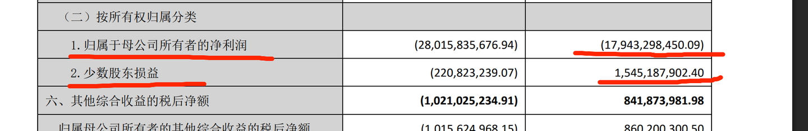

# 《地阶功法卷六》每股收益知多少

今天谈一个非常重要，非常基础，做投资必须学会的概念，也就是[每股收益](https://zhida.zhihu.com/search?content_id=266735511&content_type=Article&match_order=1&q=%E6%AF%8F%E8%82%A1%E6%94%B6%E7%9B%8A&zhida_source=entity)的计算。

在任何财经类的考试中，每股收益都是必学必考的内容。

我的读者里有很多基础非常过硬的投资者，[CPA](https://zhida.zhihu.com/search?content_id=266735511&content_type=Article&match_order=1&q=CPA&zhida_source=entity)也不在少数，粗略看了下应该有上千了。

但是也有很多小白，或者新手投资者。

同时我自己对每股收益也有一些不太成熟的看法。

所以今天的文章就深入浅出的说一下每股收益的计算逻辑。

————————————————

**基础概念：**

**1.**[**归母净利润**](https://zhida.zhihu.com/search?content_id=266735511&content_type=Article&match_order=1&q=%E5%BD%92%E6%AF%8D%E5%87%80%E5%88%A9%E6%B6%A6&zhida_source=entity)

净利润咱们经常说，这个好理解。

你开了个超市，年收入100万，扣去进货房租水电人工折旧的成本80万，最后把税一交，净落了15万，这15万就是净利润。

那么归母什么意思呢？

这个母，就是母公司的意思。

你可以理解成”我“

也就是归属于”我“的净利润。

在上面这个例子里，你的超市一开始的时候不是自己一个人开的，你二舅还入了10%的股份，大舅也入了10%的股份。

你其实只有80%的股份，所以最后那个15万，只能拿走15*0.8=12万，剩下的三万要分给大舅和二舅。

这个12万就是所谓的归母净利润。

2.[**流通在外**](https://zhida.zhihu.com/search?content_id=266735511&content_type=Article&match_order=1&q=%E6%B5%81%E9%80%9A%E5%9C%A8%E5%A4%96&zhida_source=entity)：

流通在外什么意思呢？

假设你的超市上市了，上市前100股，你有80股，大舅二舅一共20股。

IPO又发了60股给韭菜。

现在一共160股，你有80股，持股比例50%。

上市以后，股价跌跌不休。

你们一合计，这不行啊，开个股东大会。

发了个公告，说公司要回购股票了，一共回购10股。

这10股先放在公司账上，以后用来奖励店长和收银员。

这个时候，流通在外的股票就只有160-10=150股了。

所谓的内外，指的是在不在上市公司账本上。

在公司账上的叫[库存股](https://zhida.zhihu.com/search?content_id=266735511&content_type=Article&match_order=1&q=%E5%BA%93%E5%AD%98%E8%82%A1&zhida_source=entity)，一般是限制性股份什么的。

不在公司账上，可以在资本市场交易的，叫流通在外。

流通在外的概念不等于流通股本。

(这里比较绕，要多看看)

比如你的80股由于减持规定，上市以后不能立即交易，不是流通股。

但是属于流通在外的范畴，因为它是在大股东账上，而不是在上市公司账上。

判断是否流通在外的黄金标准就是股票持有人是否是上市公司本身。

3.[**普通股**](https://zhida.zhihu.com/search?content_id=266735511&content_type=Article&match_order=1&q=%E6%99%AE%E9%80%9A%E8%82%A1&zhida_source=entity)

普通股就是普通投资者拿的股票，咱们讨论的大部分股票都是普通股。

与普通股相对应的概念叫[优先股](https://zhida.zhihu.com/search?content_id=266735511&content_type=Article&match_order=1&q=%E4%BC%98%E5%85%88%E8%82%A1&zhida_source=entity)，一般是银行或者一些大型的企业发行的类似于债券的一类东西。

优先股一般不在A股交易，优先股的股东对一般的经营事务没有什么参与权，但是优先股股东可以收取优先股股息。

所谓的优先，意思就是超市破产了，货架和别的盆盆罐罐卖了5万块，这5万块要先赔给债权人，然后是优先股股东，剩下的才能轮到其他普通投资者去瓜分。

4.加权平均股数

按照时间加权计算一年之间平均的股数。

什么意思呢？

比如你年初的时候总股本是100股，7月份的时候IPO了，总股本变成160股了。

那么这一年的加权平均股数就是（100*6+160*6)/12=130股

（6个月100股，6个月160股）

如果是10月才IPO，那加权平均股数=（100*9+160*3)/12=115股

（9个月100股，3个月160股）

————————————————

基础概念学完了，咱们来学每股收益。

每股收益一般就是投资者俗称的业绩。

这个业绩大约等于净利润/总股本

你平时用这个来做决策，问题不大。

但是有些投资者用这个测算以后，发现和财报上的不一样。

那我们就需要更精确的计算。

每股收益分两种，一种叫基本每股收益，一种叫摊薄每股收益。

投资者一般看重的是前者，后者是考虑可转债或者其他潜在的股本后的每股收益。

所以这篇文章只讲基本每股收益，摊搏每股收益有兴趣的可以自学哈，原理大差不差的。

基本每股收益=（归母净利润-优先股股息-[**永续债**](https://zhida.zhihu.com/search?content_id=266735511&content_type=Article&match_order=1&q=%E6%B0%B8%E7%BB%AD%E5%80%BA&zhida_source=entity)利息)/流通在外普通股加权平均股数

和上面那个简陋的公式对比，会发现差距主要在以下几点

1.分母上，有一个流通在外的修饰词，如果一家公司有回购或者其他库存股，会导致流通在外的股数变少，也就是分母变小，从而使得真实的基本每股收益比粗略计算的更大。

2.分母上，还有一个加权平均的的修饰词，如果一家公司在一年中发生债转股，增发，或者其他股本变动，则会导致加权平均股数＜期末总股本。

很多人都是用净利润/期末总股本，从而使得真实的基本每股收益比粗略计算的更大。

3.分子上，要减去永续债或者优先股的影响，从而使得真实的基本每股收益比粗略计算的更小。

————————————————

说了这么多了，可能还是云里雾里的，咱们实战一下吧：

某银行总股本是159.1亿股，归母净利润179.82亿。

如果按照一般的粗略计算，则每股收益=179.82/159.1=1.13元/股

实际上的基本每股收益是1.04元，比粗略计算的要小。

根据我们上文的推理，则考虑是优先股或者永续债影响。

第一步：

分子的处理，先找到半年报：

半年报

半年报中表示永续债利息9.84亿，那推算三季报的永续债利息大约为9.84/2*3=14.76亿

则基本每股收益的分子为179.82-14.76=165.06

第二步：

分母的处理：

看了下股本，期间没有变动。

同时没有库存股等特殊事件，因此，就以159.15进行计算就行了。

则基本每股收益=165.06/159.15=1.04元/每股

————————————————

看到这里，恭喜你解锁了CPA考试里最难科目财务成本管理的必考内容。

看的有点晕晕乎乎的？

没关系，不重要，只要会看每股收益就行了，公司都给你算好了。

但是以我多年闯荡各种论坛的经验，每次在财报季都会有资深的投资者跳出来指责上市公司计算的每股收益有错误。

因为每股收益是一个原理看起来简单，但是实际算准并不容易的数据。

我们并不需要学会具体的计算过程，但是要可以反推出每股收益和粗略计算之间差距的原因。

————————————————

以上内容属于基础内容，下面开始拓展一下：

1.归母净利润和少数股东损益。

这是个很有趣的点，就像我们开超市，占股80%，大舅10%，二舅10%，最后应该一荣俱荣，一损俱损。

但是有的公司，特别是房企之类的非常缺钱的企业，你去观察的它的财务报表，会发现少数股东的利润特别稳。

超市赚钱的时候，大舅和二舅也赚钱很好理解。

但是超市明明都要破产了，大舅和二舅还在赚钱，是不是有点匪夷所思？

某房企财报

比如某龙头的报表，上市公司赔了这么多，少数股东还在挣钱。

（热知识，括号里的数字代表负数）

为什么呢？

一般这种情况就可以考虑明股实债了。

也可以叫做表外负债。

就是看起来是大舅二舅给你签了了个入股协议，结果仔细一瞅，后面还有个抽屉条款，你要按照约定的价格回购大舅二舅的股份。

看起来是股，实际上是债。

2.永续债和优先股的划分

这部分内容也是CPA里很重要的一个章节，在会计科目里应该是第十三章里讲金融资产的划分时会提到，一般的课程里光这部分内容就有三十个课时以上。

很多人死记硬背会计分录，即使过了也没搞清楚底层逻辑是什么。

其实说到底，就一个判断金标准，能不能无条件不还钱。

你不要管那个金融工具叫什么，永续债也好，优先股也好，可转债也好，名字不重要，叫什么都行。

重要的是你作为上市公司，在拿了钱的同时，以后可不可以不还钱。

可以不还钱的就是股，必须还钱的就是债。

如果要还一部分钱，那需要还钱的部分就是债，不需要还钱的部分就是股，这种叫复合金融工具。

就这么简单，一点都不复杂。

3.回购的影响

公司回购一般有两种，给员工的股权激励和直接注销股本。

一般人的认知里，股权激励不影响总股本，对每股收益没有影响。

注销股本减少股本，可以提高每股收益。

可是通过上文的计算公式可以得知，即使是用作股权激励，只要当期作为库存股列报在资产负债表，也会提高每股收益，因为库存股就不属于流通在外了。

但是这种影响是暂时的，当授予员工后，库存股重新流通在外时，这种影响就会消失。

同时股权激励会在当期就扣除费用，降低分子，总的对每股收益的影响需要另行计算。

————————————————

以上是知乎原版，看过的温故而知新。

**下面是圈内补充知识点：**

**1.每股收益和公司净利润，哪个对投资者更重要？**

这个问题的答案毫无疑问是前者，因为公司的净利润和投资者无关，和投资者有关的只有每股收益，用每股收益乘以股票数量，就是投资者手里的股票创造的实际价值。

因此，引申出下一个问题：

**2.什么时候每股收益的变动和公司净利润不同步呢？**

大部分总股本变动的情形都容易引发这一现象，但是最常见的是**增发，特别是定向增发！**

增发的时候，蛋糕没变大，但是分蛋糕的人多了，所以每个人分到的蛋糕就少了，是很隐秘的一种二次分配的手段。

**3.怎么看增发是利好还是利空？**

大部分情况下，增发都是中性偏利空，除非增发是用于新建项目，且新建项目回报率高于原来的项目。

比较少见，因为现在各行各业都比较卷，很少有新项目回报率高于原来项目的情形发生。

由此，又引申出另一个问题：

**4.大笔分红+频繁增发的公司，值不值得投资？**

这是一个非常容易踩的坑，有一些公司，比如某中型券商吧，在券商行业里属于现金分红很大方的公司。

但是这家券商有个传统，一边分红，一边增发。

说他缺钱吧，他经常分红。

说他大方吧，一言不合就给股东伸手要钱。

这类公司因为增发来的钱没有好项目投，所以原有股东的权益被不断稀释，最后股东眼睁睁看着自己分到的蛋糕越来越少，是一个非常有迷惑性的坑。

**5，还有哪些资本运作会影响每股收益？**

第一个是**回购+注销**，这个是利好，因为相当于分蛋糕的人少了，每个人分到的蛋糕就大了。

第二个是**股份支付费用计提**，这个是利空，因为股份支付不是行权的时候才计提费用的，而是做出决定就要开始计提。

第三个是**优先股发行**，利息要从净利润中扣除。

第四个是**换股吸收合并**，这个不好说利空还是利好，要取决于对价和吸收的资产质量。

第五个发行**可转债**，这个发行后会影响稀释每股收益，如果以后转股了，就会影响当期每股收益。

第六个是发行**可转换优先股**，这个类似于可转债。

不过这里有个特例，叫**可交换债券。**

这个发行以后，不会影响每股收益，它和可转债不同，是两个东西，不会增加新股，而是从已经有的存量股份里进行交换。

————————————-

铝的库存数据也更新下吧：

本周去库4.9万吨，较前两周的5.9万吨历史较高的去库速度有所下降，但依然保持在高水平去化。

————————————

码着字一看行情，突然没啥兴致了。

今天跌成这样子，估计大家也没啥心思看基本面的数据，那就聊一聊最近的情况。

目前我的持股体验，大概在历史分位值是70分位左右，比历史上70%的时间内都更难难受，是标准的熊市股灾体验。

如果重仓一个板块的话，这个难受程度可以给到80分位。

如果重仓一个个股的话，那能有90分位的痛苦程度。

但是如果加上杠杆，那可能就是99分位了。

新手碰到这阵仗还能绷得住的，那真是天生的大心脏了。

反正我要是一出新手村就碰到这行情，肯定心态就炸了。

要说有什么可以安慰大家的话语，那可能就是6月份还有几个交易日就结束了，玄学一点来讲，也许7月份会翻身。

但是指望玄学肯定是不行的，其实是分红马上到账了，说不定会给一个很好的位置。

分红到账的规则是开完股东后两个月内必须分，大多数情况下一般是一个月左右，有一些手脚麻利的企业一个星期就搞定。

最近我收到了不少回头钱，很多持仓都分红了，但是我没买。

因为不看好这个月的行情，所以打算留到下个月业绩明朗了，找一些高股息的加进去。

股息的投资韧性在于，跌的越多，复投的比例就越大，未来预期股息率就越高，和没有股息的股票有着本质的不同。

不要小看六七个点的股息，它不是一次性的，而是年年如此，最差无非拿个十五六年，股票白送。

A股是很差，但是不至于差到十几年内都没有让你提前兑现收益的可能。

如果最差的结局都可以接受了，看现在的行情也不算什么，就是多被恶心一阵。

这种行情下，只要不赌气，不梭哈，不上杠杆，一直坐在牌桌上，总有出牌的机会。

所以要控制住抄底和赌气的欲望，用时间去战胜波动。

没有人在投资之路上可以一帆风顺。

重要的是每次跌到都能爬起来，并且走的更远。

而股息，就是那个可以让我们哪怕踉踉跄跄也可以渐行渐远的拐杖。

————————————

一个喜欢保护韭菜的博主，希望大家少少踩坑，多多赚钱！！！

